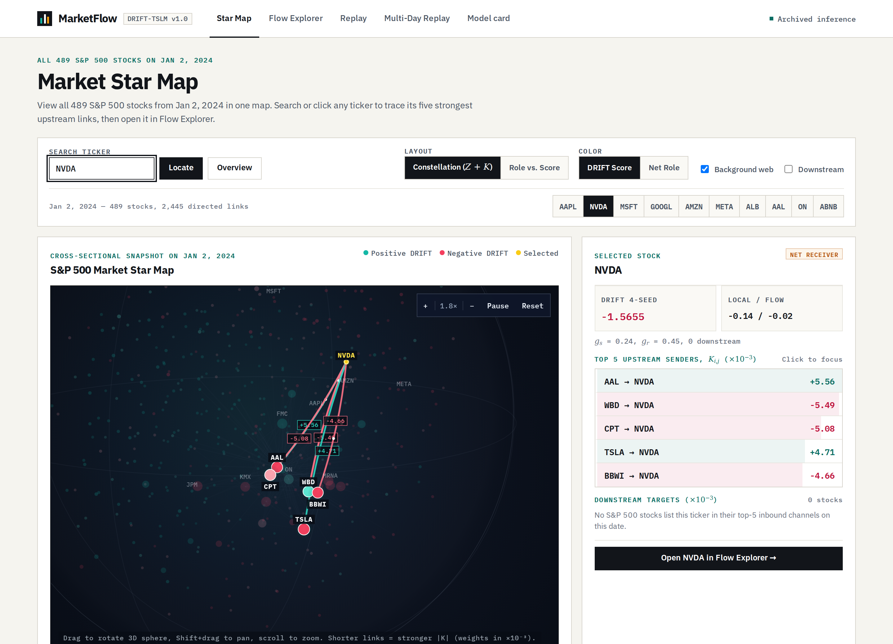

# MarketFlow — DRIFT-TSLM v1.0

**Live Demo**: https://marketflow-drift.vercel.app

At a historical market close, which stocks drive a target’s DRIFT signal, and what happens if one incoming channel is masked? MarketFlow pairs a frozen four-seed DRIFT cross-sectional directed-flow backbone with **Qwen3.5-4B** reading 25 DRIFT numeric tokens directly—no edge weights, norms, or target scores appear in text prompts.

## Interactive Demo (Zero-GPU Static Build)

- **Live deployment**: https://marketflow-drift.vercel.app
- **Local build**: `npm --prefix web run build && python3 -m http.server 8000 --directory web/dist`
- **Offline package**: [reports/marketflow-static.zip](reports/marketflow-static.zip) (167 KB)

Included offline assets:
- **3D Market Star Map**: All 489 S&P 500 stocks (2,445 top-5 directed links on Jan 2, 2024) arranged inside a 3D volumetric sphere where geometric distance reflects edge strength (`Spearman(|K|, dist3D) = -0.9592`).
- **Flow Explorer & Historical Replay**: 96 stock-days (12 test dates in 2024–2025 × 8 stocks), 1,344 cached Qwen3.5-4B responses across all four tasks, and 480 single-edge interventions ([Flow Explorer screenshot](reports/v2_demo.png)).
- **Multi-Day Replay**: 28 dual-market 5-session persistent-flow counterfactuals across S&P 500 ([screenshot](reports/v2_multiday_sp500.png)) and CSI 300 ([screenshot](reports/v2_multiday_csi300.png)), comparing today-only, 5-day, and 4-day-masked-then-restored schedules.
- **Optional GPU API**: `bash web/serve.sh`

The original DRIFT runtime and four-seed paper ensembles run via `./run.sh verify`, `./run.sh load --cell alpha158us_sp500_pit`, and `code/paper_ensemble.py`.

## Model & Training (Qwen3.5-4B)

20 sessions × 157 Alpha158-US factors → frozen seed-0 DRIFT → six modality projectors → **Qwen3.5-4B** with 32-layer LoRA. Stock tickers sit beside their numeric tokens (25 tokens for single-stock questions, 20 for pairwise). Trained on 24,000 examples (`2018–2022`) with 750 alignment steps and 5,000 joint SFT steps (3× loss weight on the answer span); checkpoint selected on `2023` validation (`step 5000`). All Qwen3.5-4B training, evaluation, API, and export code lives under `code/TSLM_training/`.

### 1. Held-out questions (2024–2025)

1,000 questions per task across 500 trading days. Exact accuracy requires valid reasoning format and every JSON field correct.

| Model | Attribution | Masked edge | Role & regime | Pair, both fields |
|---|---:|---:|---:|---:|
| Zero-shot Qwen | 3.1% | 18.7% | 3.1% | 23.3% |
| Returns-only OpenTSLM + Qwen | 2.2% | 17.0% | 5.4% | 24.9% |
| DRIFT + Qwen | **45.9%** | **84.5%** | **85.1%** | **45.5%** |

### 2. Token-grounding controls (passed)

Each diagnostic task must drop by at least 15% under both same-day mismatched and zeroed DRIFT tokens.

| Task | Real | Mismatched | Zeroed | Gain vs. mismatch / zeroed |
|---|---:|---:|---:|---:|
| Attribution | 45.9% | 3.0% | 2.0% | +42.9% / +43.9% |
| Masked edge | 84.5% | 21.2% | 28.2% | +63.3% / +56.3% |
| Role & regime | 85.1% | 14.4% | 5.6% | +70.7% / +79.5% |

### 3. Pairwise return ranking

Native reference ranks each pair by the four-seed DRIFT ensemble. Qwen margin is the `A` minus `B` logit at the JSON `winner` field after generating its own reasoning (1,000 pairs per cohort).

| Pair cohort | Native win / AUC | Qwen margin win / AUC | Generated winner |
|---|---:|---:|---:|
| Top vs. bottom quintile | 49.80% / 0.5016 | 49.65% / 0.5036 | 49.9% |
| Whole-market random | 53.10% / 0.5288 | 53.05% / 0.5253 | 52.3% |

### 4. Paper stock-ranking benchmarks

Daily cross-sectional IC, RankIC, and cumulative gross top-quintile return (zero transaction cost).

| Alpha158 market | LightGBM (IC / RankIC / return) | DRIFT 4-seed (IC / RankIC / return) |
|---|---:|---:|
| S&P 500 Alpha158 | 0.0060 / 0.0058 / 38.36% | 0.0163 / 0.0180 / 52.86% |
| CSI 300 Alpha158 | 0.0188 / 0.0204 / 61.45% | 0.0290 / 0.0553 / 69.18% |

## TimeNet Dataset Connector

The TimeNet connector patch ([data/prompt_data/drift-alpha158-flow.patch](data/prompt_data/drift-alpha158-flow.patch)) provides both the anonymous open-access release (`10eit/drift-alpha158-flow-public`, 98 observations, 30 stocks, 11 sectors, 392 tasks) and the full 240-observation research edition (`10eit/drift-alpha158-flow`). See [data/prompt_data/timenet_pr.md](data/prompt_data/timenet_pr.md) for reproduction commands.

[Model card screenshot](reports/v2_model_card.png) | [Static demo ZIP](reports/marketflow-static.zip) | [Web & API instructions](web/README.md)
